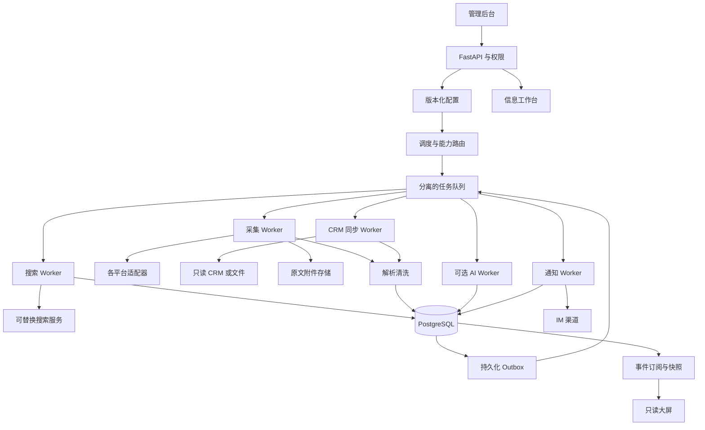

# 架构基线

## 运行边界

业务入口：关键词发现、指定平台监测、客户内外部资料汇集。客户 ID、AI 分析、CRM 和推送均可缺省。基础运行依赖数据库、队列、存储和至少一个实际可用的发现来源；全部来源不可用时等待恢复。

## 模块约定

任务载荷：task_id、kind、source_id、customer_id（可空）、input_ref、config_version、idempotency_key、trace_id、scheduled_at。状态：queued、running、retry_wait、action_required、succeeded、failed、cancelled。

任务从数据库可靠投递到队列；队列采用至少一次语义，消费者幂等。数据库事务保存业务结果和 Outbox 事件，投递器可重试。租约/心跳回收卡住任务；源/账号配额限制并发；通知与浏览器 Worker 资源隔离。配置修改对新任务生效，凭证撤销立即阻止后续访问。

搜索输出链接和来源元数据；采集输出正文/附件引用；清洗输出标准信息；AI 输出独立分析记录；通知输出发送记录。模块只通过约定服务或事件修改所属数据，禁止任意跨模块写表。

## 数据模型草案

| 数据域 | 实体 | 关键约束 |
|---|---|---|
| 配置 | monitor_rules、sources、provider_configs、config_versions | 版本化；启停、频率、预算、主备优先级 |
| 授权 | accounts、credential_refs | 加密/密钥引用；凭证不进入事件或日志 |
| 客户 | customers、customer_aliases、internal_records、sync_cursors | CRM 外部 ID 唯一；名称匹配不确定则待核实 |
| 证据 | documents、document_versions、attachments | URL、内容指纹、发布时间与采集时间分开；原文可追溯 |
| 信息 | information_items、customer_item_links | customer_id 不强制；同事件多来源关联，更新保留版本 |
| 分析 | analysis_runs | 模型、提示版本、证据引用、执行状态；缺少分析不阻塞信息 |
| 执行 | tasks、task_attempts、source_cursors | 幂等键唯一；租约、重试、恢复游标 |
| 事件 | outbox_events、execution_events | 事件 ID、顺序游标、保留期；过期可快照恢复 |
| 通知 | notifications、delivery_attempts、acknowledgements | 通知幂等键；发送、送达、已读、人工确认分开 |
| 管理 | users、roles、audit_logs、usage_records | 管理员/操作员/展示角色；金额与额度独立统计 |

原型交互通过后细化列、索引、外键及迁移，不预先把草案当成生产 schema。

## 初始 API 边界

`/api/v1/rules` 规则草稿、测试、启停；`/network-rules` 网络采集规则与统计；`/providers` 密钥引用及预算；`/items` 信息与证据；`/customers`、`/customer-signals` 客户档案与动向；`/tasks` 任务查询与安全重试；`/xiaohongshu` 小红书账号与采集；`/dingtalk/groups` 钉钉群；`/display/snapshot` 脱敏快照；`/display/events` SSE；`/display/items` 按时间/来源/地区下钻。

异步动作返回 task_id（202），不得让请求等待完整采集链路。列表分页与稳定排序；筛选可映射 URL。错误返回错误码、可读原因、可执行建议与 trace_id，不能返回凭证。展示端使用独立受限授权，内部记录不通过前端简单隐藏实现保密。

## 部署与安全

初期单仓库、FastAPI、独立 Celery Worker/调度器、PostgreSQL、Redis、文件卷，以 Compose 部署。健康检查区分进程存活和业务推进。数据库备份与恢复演练、队列持久化、存储限额、日志保留期均属上线要求。

浏览器隔离运行。抓取外部 URL 校验协议、DNS/IP 和重定向，阻止 SSRF；提取文本不直接作为 HTML 渲染；外部内容对模型是非可信数据。遵守来源授权，受限时暂停；不以轮换账号规避封禁。单机部署不宣称基础设施高可用，后续按需要增加托管或冗余部署。
