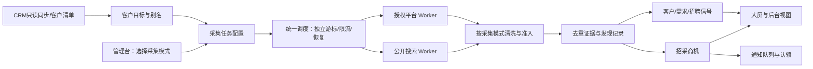

# 多类型采集与来源策略设计

基线：2026-11-15。当前已实现 public_tender 筛选，其余类型是后续设计，尚未接入账号或 CRM。

## 业务边界

| 采集模式 | 用户提供 | 搜索/读取范围 | 保留内容 | 展示/通知 |
|---|---|---|---|---|
| public_tender 全网招采 | 业务关键词 | 搜索引擎可发现的公开信息 | 信息化、AI、智能制造相关招投标与采购公告 | 当前商机库，沿用推送/认领 |
| customer_watch 客户监测 | 客户名单/CRM只读连接、客户别名及内部服务记录 | 以客户实体为目标，可跨官网、新闻、自媒体、招采站点 | 该客户的相关招采、扩产、产能、信息化和智能制造资讯 | 独立客户动态框/客户信息环；默认不自动套用招采推送 |
| social_demand 社交需求 | 指定平台、关键词、可用授权账号/数据接口 | 平台内可访问内容 | 原帖明确表达的软件/信息化需求，允许口语、无金额 | 需求线索视图；推送策略单独配置 |
| recruitment_signal 招聘信号 | 招聘平台、关键词、账号/可用接口 | 企业岗位与招聘信息 | 信息化/ERP/MES/AI等相关招聘 | 招聘信号视图，不等同采购商机 |
| enterprise_procurement 企业采购 | 平台URL、企业范围、账号/扫码授权（需要时） | 企业SRM/采购栏目 | 相关采购、招投标公告 | 商机库；可标注企业直采来源 |

CRM 是客户目标和内部记录的来源，不代表外部只爬 CRM 或客户官网。账号也是按连接配置可选，并非所有入口都必须有账号；连接器的实际授权方式需逐平台核实。

## 保持低耦合的组织方式

保持模块化单体 + 独立 Worker，不建五套重复系统。采集模式决定“为什么取/允许保留什么”；连接器决定“从哪里/如何取”。例如同一个 SearXNG 连接器可服务全网招采和指定客户监测，但使用不同目标与准入策略。一个客户目标可通过多个连接器查找信息。

统一协议字段：task_id、collection_id、source_type、connector_id、target_id（可空）、account_ref（可空）、cursor、policy_version、idempotency_key。账号引用可入任务，凭据不可入队列。

准入策略独立：public_tender 要求相关采购公告证据，customer_watch 先确认客户匹配再判断事件相关性，social_demand 判断需求表达，recruitment_signal 判断岗位职责，enterprise_procurement 判断公告类别/相关性。不能把 public_tender 的“没有招采公告就丢弃”应用到客户动态。

## 数据模型演进（计划）

- collection_configs：采集模式、连接器、目标范围、关键词、执行/保留/通知策略、启用状态与配置版本。
- connectors / account_refs：接口能力、授权方式、账号健康、凭据引用；会话凭证独立加密保存。
- customers / customer_aliases / crm_sync_cursors：稳定客户ID、规范名、别名、外部映射；按增量同步。
- documents：原始证据、规范URL、正文指纹、来源日期与采集日期，复用现有文档结构。
- discoveries：一次“通过某模式/连接器/目标发现某文档”的关联记录，记录匹配证据及准入决定。
- information_items：业务条目，增加 item_type（采购/需求/招聘/客户动态），不拿 provider 名称充当业务类型。
- customer_item_links：一条信息可对应多个客户，保存匹配证据，重名/子公司不自动强行合并。
- deliveries / claims：保留现有发送和认领状态，与业务条目关联，不让外部 IM 成为采集依赖。

去重分两层：原始内容跨入口去重；每种采集目的单独判断准入。一条公告同时从搜索和企业 SRM 找到，只生成一条商机并保留两个来源；同篇客户新闻在全网招采模式被拒绝，不得因此禁止客户监测接收它。

**现有 removed_evidence 指纹是全网模式的历史实现。接第二种模式前必须迁移为带 source_type/target_scope 的去重或拒绝记录，并调整 service 的全局 URL 提前返回逻辑；否则此前被公共搜索拒绝的客户新闻会被误拦截。** 已推送条目的通知幂等与内容去重分离，避免跨模式重复推送。

## 并行与故障隔离

- 搜索、浏览器会话、CRM同步、通知使用独立队列/Worker资源；初期保留现有 Redis/PostgreSQL/Celery体系，不额外建设分布式平台。
- 游标按 collection + connector + query/target + config_version 独立维护。
- 限流/验证码按连接器或账号冷却；登录失效停用该账号任务，其他来源继续。修复授权后从对应游标恢复，不重跑全系统。
- CRM 同步失败时，可继续用最后一次成功同步的客户清单，并标记清单更新时间；不影响全网招采。
- 采用轮询/公平调度为各类任务留资源，避免大量关键词搜索占满浏览器或客户监测。数据库/Redis本身仍是共同基础设施，单机部署不宣称无条件高可用。
- IM 失败保留通知待发，采集照常。不同模式是否通知、通知频率分别配置，不把客户新闻自动当采购通知发送。

## 管理与展示

管理台入口为“新增采集任务”，先选模式，再只显示该模式所需的字段。任务列表显示来源/目标、最后成功、最后新增、状态和需处理动作；账号管理单独处理扫码、过期与恢复。

当前大屏商机库仅承载招采。后续增加独立客户动态框，点击进入客户时间线与内部服务记录；社交需求、招聘信号另设筛选视图。图表口径绑定 item_type，招聘数、新闻数不能混入采购商机数。

## 实施顺序与验收

1. 当前先落实全网招采范围与历史重整，保留正常采购及推送/认领记录。
2. 建 collection_configs、source_type、discoveries 及带范围的拒绝/去重规则；迁移现有全网任务，旧界面继续可用。验证跨模式不误去重、同商机不重复通知。
3. 用用户提供的少量客户名单先跑 customer_watch，确认重名匹配、相关资讯、独立客户框；再接 CRM 增量同步和内部服务记录。
4. 选一个企业采购平台接通，验收登录过期、公告及附件读取、断点恢复，再扩平台。
5. 小红书与招聘分别选一个实际账号/授权入口做能力验证；支持的接入方式确认后再开发专用连接器。一个来源不可用不阻塞其他阶段。
6. 联合验收：CRM掉线、一个平台掉线、IM掉线时其余任务继续；重启恢复游标，内容不重复、消息不重复、视图不串类。

## 2026-11-15 客户监测试点实现

已增加 `customers`、`customer_signals`，复用 `monitor_rules`，增加 `source_type` 和 `customer_id`。客户监测用独立 `customers` 队列和 Worker，复用原有搜索、游标、任务、Outbox、租约恢复。全网规则仍走 `collection`。同一搜索引擎限流时共享冷却，避免换客户后继续冲击受限入口。

管理台“客户监测”可添加全称、简称和可选官网，保存即启用；每家客户可单独启停，查看最后搜索、最后新增、当前搜索词及入口错误。独立客户动态表支持客户筛选、分页和原文查询，大屏同样有独立区域。日期和原文片段来自搜索证据；首版仍只有搜索摘要，未实现正文抓取、CRM内部记录和AI分析。

客户动态先匹配全称/已配置简称，或精确匹配管理员配置的官网主机，再筛选招采、扩产产能、信息化与智能制造。没有可信日期、过期信息会归档，主列表只展示近30天。公司身份仍需要人工核对，子公司不会自动扩展到监测名单。

客户动态存入独立业务表，不生成 `information_items` 或 `deliveries`，不会进入商机计数、蜘蛛搬运或钉钉推送。客户证据仍保存在 `document_versions`，身份键使用客户范围；URL与内容指纹在每个客户内去重。现有 `removed_evidence` 明确限定全网招采分支使用，清理脚本跳过客户任务，因此全网曾排除的新闻仍能被指定客户监测接收。跨客户/跨模式的原文物理复用留待后续迁移，当前优先确保准入与删除范围隔离。

真实客户名单只保存在本机数据库与忽略的运行目录，不进入公开仓库。CRM、招聘和自媒体账号连接仍未接入。

## 小红书需求接入

已增加独立 social 队列、扫码管理页、站内搜索和笔记正文读取，复用来源终端→蜘蛛→信息库。需求与全网招采分开准入，暂不自动推送；账号异常只暂停小红书。接入步骤与限制见 XIAOHONGSHU.md，真实验收进度见 IMPLEMENTATION-STATUS.md。
