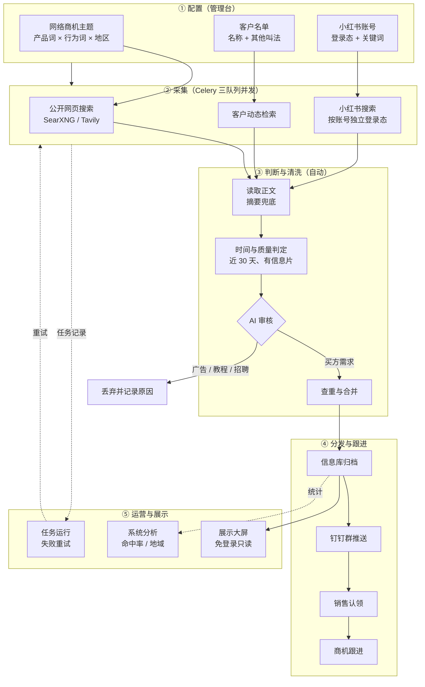

# 功能架构

## 定位

把公开网络上散落的采购与需求信号，自动找出来、判断真假、归档，并推到钉钉让销售认领跟进。

一句话边界：**只读公开信息，不做发布、评论、私信等任何写操作。**

## 谁在用

| 角色 | 能做 | 不能做 |
|---|---|---|
| 系统管理员 | 全部配置、全部账号、用户管理、大屏令牌 | — |
| 成员 | 建立/修改自己的采集主题与小红书账号；查看全部信息 | 改他人主题与账号；用户管理 |
| 大屏（免登录） | 只看展示页 | 任何操作 |

## 功能地图

| 能力域 | 入口页面 | 唯一职责 |
|---|---|---|
| 采集配置 | 网络商机 `/rules` | 定义「搜什么」：产品词 × 行为词 × 地区 |
| | 客户动向 `/customers` | 定义「盯谁」：客户全称与其他叫法 |
| | 小红书采集 `/xiaohongshu` | 定义「用哪个号搜什么」：一账号一登录态一关键词组 |
| 运行与加工 | （后台自动） | 搜索 → 取正文 → 时间与质量判定 → AI 判断买方需求 → 查重合并 |
| 信息消费 | 信息库 `/information` | 所有入库信息，点标题看原文 |
| | 任务运行 `/tasks` | 每条任务的执行记录，失败的能重试 |
| | 系统分析 `/analysis` | 采集命中率与商机地域分布 |
| 分发与跟进 | 钉钉群＋大屏 | 入库即推送，群成员认领，认领后进跟进流程 |
| 账号与权限 | 用户管理 `/users`、账号中心 | 账号、角色、API 密钥、大屏令牌 |

## 主流程

## 关键产品规则

1. **时间窗口**：只保留近 30 天的信息；超出即归档，不推送。
2. **判断标准**：买方需求（有人在找、在采购）才推送；接单广告、教程、招聘、话题帖一律过滤，并在信息库保留原因。
3. **去重**：同一事件多来源命中会合并为一条，保留最早证据；同一笔记重复搜索不再重复读正文。
4. **账号隔离**：每个小红书账号一路独立登录态；某账号登录失效只暂停该账号，其他采集照常。
5. **权限边界**：规则与账号全员可见（只读），建立者与管理员可操作。
6. **免登录大屏**：仅展示，令牌可随时重新生成使旧链接失效。

## 明确不做

- 不做发布、评论、点赞、私信等写操作，不绕平台风控。
- 不做 CRM 双向同步、不做外部爬虫集群——发现来源保持可替换的最小集合。
- 不在信息未判断前推送给销售：推送的前提永远是「已入库 + 已判断为买方需求」。

## 异常怎么表达给用户

| 情况 | 页面呈现 | 用户动作 |
|---|---|---|
| 搜索服务限流 / 不可用 | 主题状态显示「采集异常」+ 悬浮原因 | 等待自动重试，或点任务重试 |
| 小红书登录失效 | 账号状态显示「登录失效」 | 对该账号扫码登录，等待中的任务自动继续 |
| AI 审核未完成 | 信息状态为「待核实 / 审核异常」 | 可手动重新审核 |
| 任务失败 | 任务运行里显示原因 | 点「重试」重新入队 |
